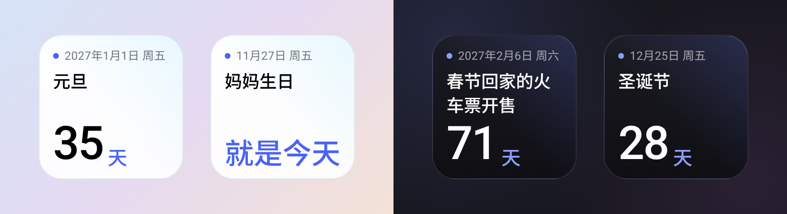

<div align="center">


# 最近倒数日 · MiCountdown

把小米日历里**最近的一个倒数日**放到桌面上。

[下载 APK](https://github.com/NormanMises/MiCountdown/releases) · Android 8.0+ · 只需日历读取权限 · 应用内提示新版本



<sub>示意图：浅色 / 深色模式下的 2×2 小部件</sub>

</div>

---

## 特点

- **自动挑最近的一个**：从小米日历的倒数日中，选出今天或之后最近的一个，不用手动设置
- **一眼看清**：上方是目标日期和星期，中间是事件名称，下方是醒目的剩余天数；当天会显示「就是今天」
- **自适应**：长标题最多三行并自动缩小字号；跟随系统深浅色模式；在 Android 12+ 上自动居中成正方形卡片
- **省心**：系统约每 30 分钟刷新一次，打开应用时也会立即刷新
- **自动提示更新**：打开应用时检查 GitHub 上的最新版本（最多每 6 小时一次），有新版会在页面上提示，点「下载」即可获取安装包
- **轻量、隐私友好**：敏感权限只有「读取日历」一项；网络只用来向 GitHub 查询最新版本，不上传任何数据

## 安装

1. 从 [Releases](https://github.com/NormanMises/MiCountdown/releases) 下载最新的 `MiCountdown-<版本>.apk` 并安装。
2. 打开「最近倒数日」，授予日历读取权限，并选择 **始终允许**（不要选「仅在使用中允许」，原因见[常见问题](#常见问题)）。
3. 点 **添加到桌面**，按系统提示确认。

> [!TIP]
> 如果桌面不支持一键添加：在桌面双指捏合 → 打开「小部件」→「搜索 → 安卓小部件」→ 选择「最近倒数日」。入口名称和位置可能随澎湃 OS 版本变化。

点击小部件会打开应用：上方是放大的卡片，下方列出所有未来的倒数日（重复的倒数日只显示最近的一次）；打开应用的同时会刷新小部件。

## 常见问题

**为什么不在小米的小部件列表首页？**
小米主卡片列表由小米审核和发布，本项目通过 GitHub 侧载分发，所以要在「安卓小部件」里找。参见 [小米开发者文档](https://dev.mi.com/xiaomihyperos/documentation/detail?pId=1664) 和 [小部件审核与上传指南](https://dev.mi.com/xiaomihyperos/documentation/detail?pId=1588)。

**应用里能看到倒数日，桌面小部件却读不到或不更新？**
多半是日历权限选成了「仅在使用中允许」。小部件在后台刷新，这时应用不算「使用中」，系统会拒绝读取日历。到 **设置 → 应用设置 → 应用管理 → 最近倒数日 → 权限 → 日历**，改为 **始终允许**（菜单名称可能随澎湃 OS 版本略有不同），然后打开一次应用刷新小部件。

**小部件显示「暂无未来的倒数日」？**
确认小米日历里有今天或之后的倒数日。已经过去的一次性倒数日不会显示。

**支持其他品牌的手机吗？**
小部件本身能在任何 Android 8.0+ 桌面上运行，但数据来自小米日历的倒数日，其他日历应用创建的普通日程不会被读取。

## 工作原理

<details>
<summary>倒数日期是如何计算的</summary>

- 只读取 `hasExtendedProperties=9` 的日程（小米日历的倒数日）。
- 目标日期和重复方式取自扩展属性 `key_countdown_info`。按月或按年重复时，跳过没有原始日期的月份或年份（例如每月 31 日会跳过小月），与小米日历的行为一致。
- 没有小米扩展数据的标准重复日程，使用 Calendar Provider 的实例日期，最多向后查询八年。
- 已过去的一次性倒数日不显示。

</details>

## 开发

### 构建

需要 JDK 17、Gradle 8.9+ 和 Android SDK 35：

```bash
gradle :app:assembleDebug
```

也可以在 GitHub Actions 中手动运行 **Build APK** 工作流，下载生成的调试 APK。

### 项目结构

| 路径 | 说明 |
| --- | --- |
| `CountdownWidget.java` | 小部件的刷新与渲染 |
| `CalendarData.java` | 查询日历并找出最近的倒数日 |
| `CountdownDates.java` | 按月 / 按年重复的日期推算 |
| `MainActivity.java` | 放大预览、授权、添加到桌面 |
| `res/layout/widget_card.xml` | 小部件布局 |
| `res/values/widget_styles.xml` | 小部件文字与卡片样式 |
| `res/values*/widget_colors.xml` | 浅色 / 深色配色 |

### 发布新版

改 `app/build.gradle` 里的 `versionCode` 和 `versionName`，推到 `main` 就行。

Actions 发现 `main` 上的版本号还没有对应的 `v<版本>` 标签时，会自动：

1. 运行 `assembleRelease`，校验 APK 的版本号、签名和非调试状态；
2. 在这个提交上打 `v<版本>` 标签，创建 GitHub Release，并附上 `MiCountdown-<版本>.apk`。

版本号没变的提交、其他分支和 PR 只生成调试版 APK，供测试下载。手动推送 `v*` 标签也会按同样的流程发布。

官方仓库通过 Actions Secret `ANDROID_SIGNING_KEYSTORE_B64` 使用既有签名，保证新版可以覆盖安装。

## 许可证

[MIT](LICENSE)
